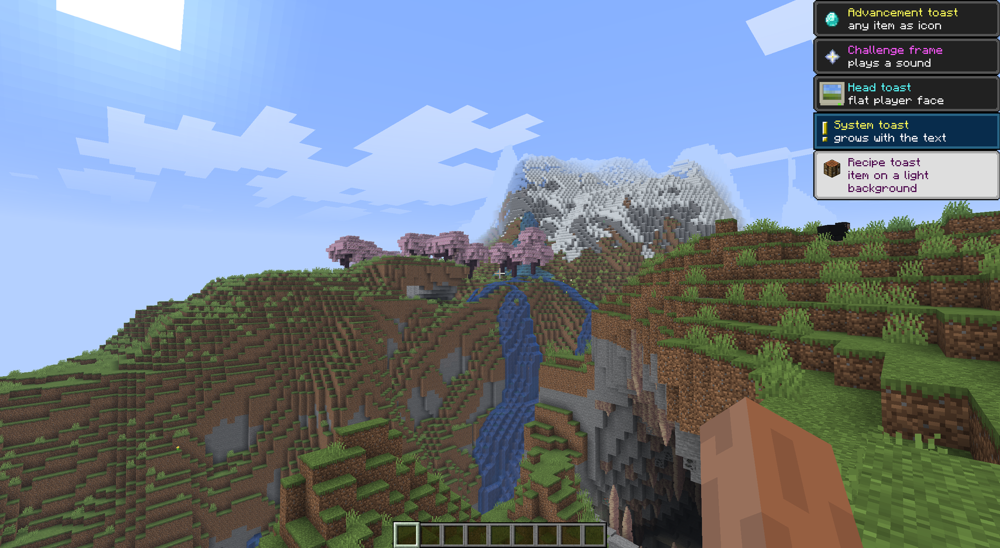
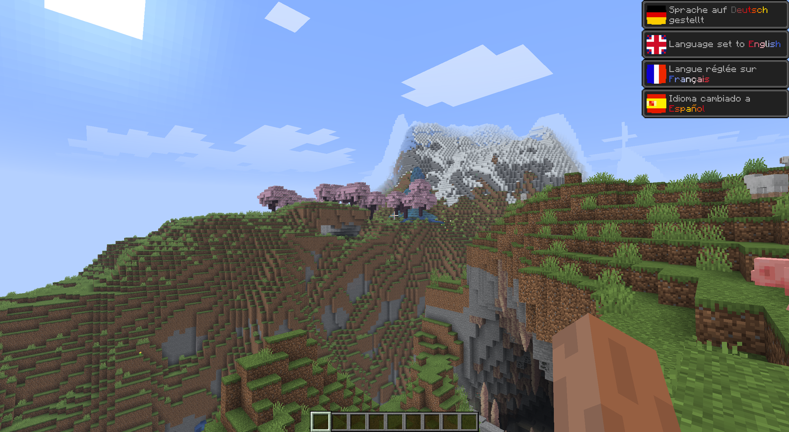

# open-toast

> Conquer minecraft toasts with your custom icons and messages.





> Bots examples can be found in the demo module!

## Quick start

Add the dependency:

```kotlin
repositories {
    maven("https://repo.pauli.fyi/releases")
}

dependencies {
    implementation("fyi.pauli.opentoast:open-toast-api:1.1.6")
}
```

Players need a resource pack for the toasts to look right.

You need to build the pack once, at this point it also downloads some assets from Mojang.
You also need to send the pack to the player.
#### Kotlin

```kotlin
val pack = ToastPack.build(dataFolder.toPath().resolve("vanilla"))
player.sendResourcePacks(pack.requestBuilder(URI("https://example.com/pack.zip")).build())

player.toast(ItemStack.of(Material.DIAMOND), Component.text("Hello!"))
player.toast(player.playerProfile, Component.text("New friend request"))
player.systemToast(Component.text("Server restart in 5 minutes"))
player.recipeToast(ItemStack.of(Material.CAKE), Component.text("Party perk unlocked"))
player.tutorialToast(TutorialIcon.MOUSE, Component.text("Look around"))
```

#### Java

```java
ToastPack pack = ToastPack.build(getDataFolder().toPath().resolve("vanilla"));
player.sendResourcePacks(pack.requestBuilder(URI.create("https://example.com/pack.zip")).build());

Toast.advancement(ItemStack.of(Material.DIAMOND), Component.text("Hello!")).show(player);
Toast.head(player.getPlayerProfile(), Component.text("New friend request")).show(player);
Toast.system(Component.text("Server restart in 5 minutes")).show(player);
Toast.recipe(ItemStack.of(Material.CAKE), Component.text("Party perk unlocked")).show(player);
Toast.tutorial(TutorialIcon.MOUSE, Component.text("Look around")).show(player);
```

If you already have a custom resource pack you can merge the open-toasts pack with your own pack!


#### Kotlin

```kotlin
val pack = ToastPack.build(dataFolder.toPath().resolve("vanilla"))
val merged = pack.mergeInto(Path.of("your-pack.zip").readBytes())

player.sendResourcePacks(merged.requestBuilder(URI("https://example.com/pack.zip")).build())
```

#### Java

```java
ToastPack pack = ToastPack.build(getDataFolder().toPath().resolve("vanilla"));
ToastPack merged = pack.mergeInto(Files.readAllBytes(Path.of("your-pack.zip")));

player.sendResourcePacks(merged.requestBuilder(URI.create("https://example.com/pack.zip")).build());
```
